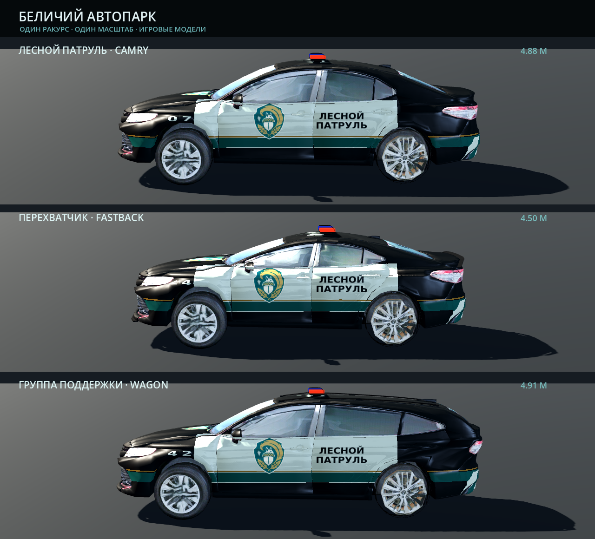
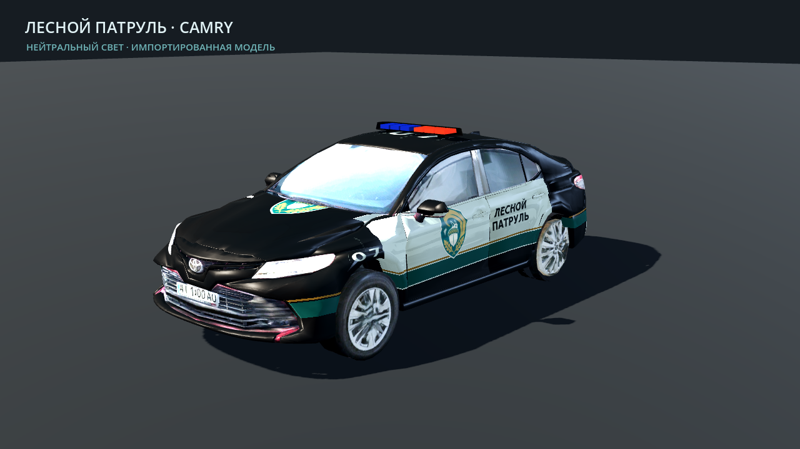
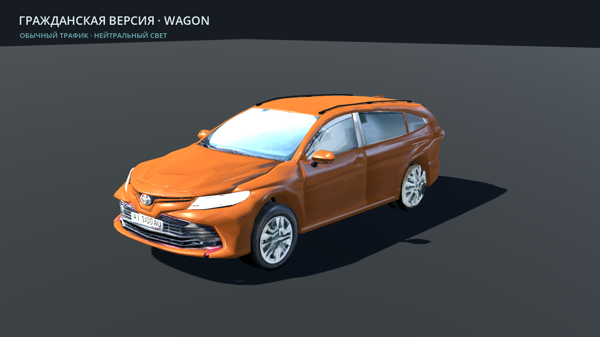
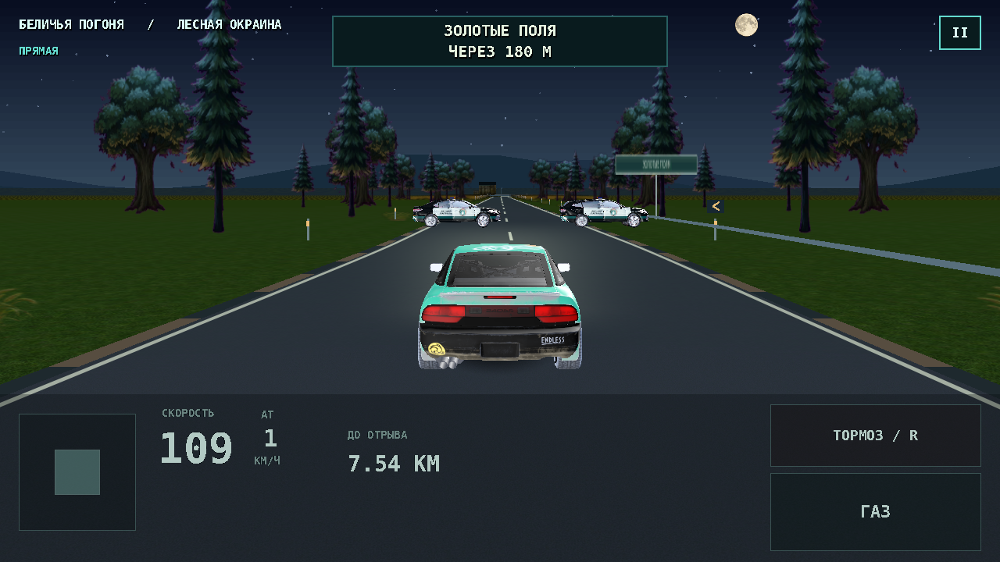

# Беличий автопарк — 1.55

Все три машины сделаны на основе исходной Camry пользователя. Перехватчик
получил укороченный кузов, низкую крышу и небольшой обвес; универсал — длинную
крышу, другой задний силуэт и рейлинги. Колёса, основные панели, фары и UV
взяты из исходной модели.

Ливрея беличьей полиции: графитовый кузов, светлые двери, бирюзовая полоса,
эмблема жёлудя, кириллические надписи и номера экипажей. Гражданские варианты
для встречки имеют отдельные цвета и обходятся без полицейской атрибутики.

Это постановочные кадры реальных игровых ресурсов в Godot Compatibility.
Сравнение использует отдельные камеры только в инструменте просмотра;
в Level 2 машины используют общую игровую камеру. Снимки не являются
записью с телефона или измерением его FPS. Хеши исходников и кадров находятся
в `preview-provenance.json`.
